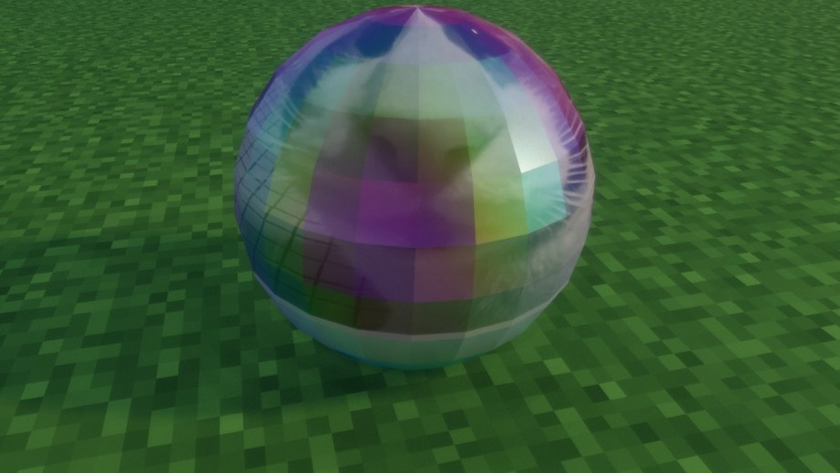
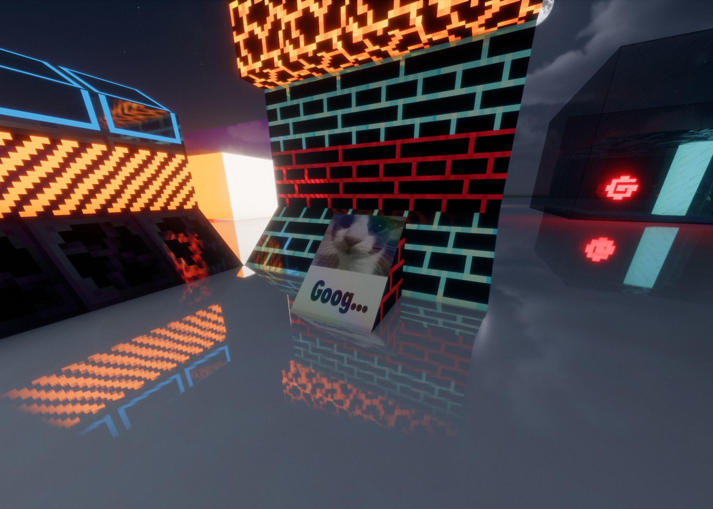
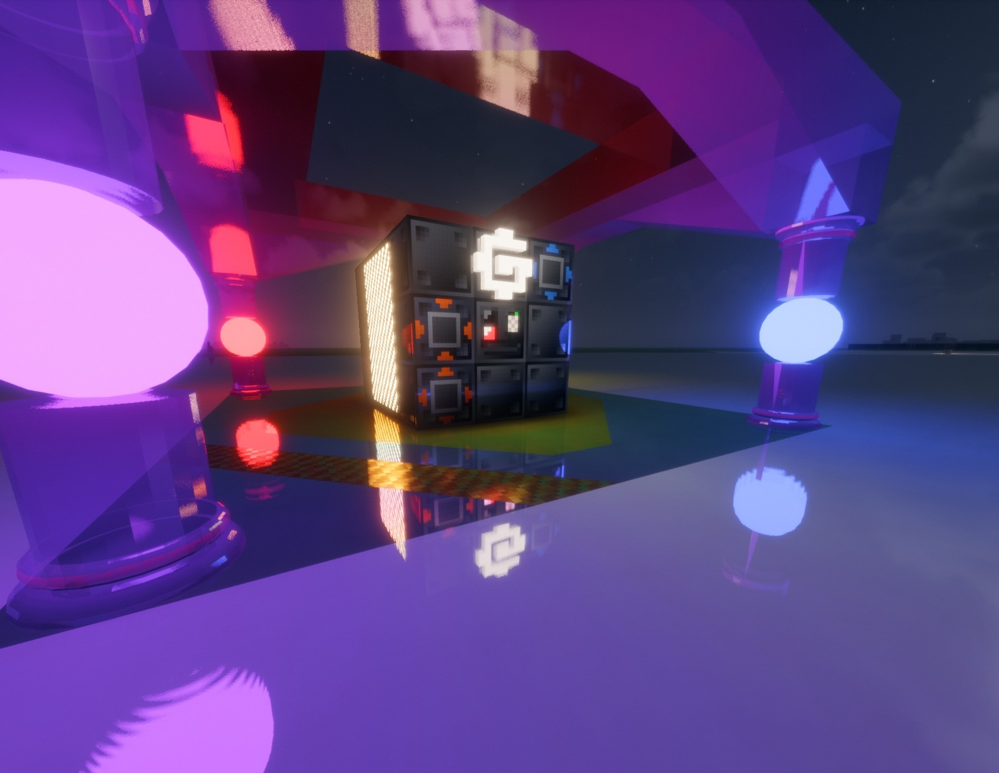

# SUSY Shader Option



*Shape: [ArchitectureCraft: Renovated](https://github.com/NeoRussia/ArchitectureCraft-Renovated). The prismatic film over it is the shader's.*

Installer for the **Suspicious Speculars** shader pack: a Forge 1.12.2 mod with a coremod hand-over, the
patch data it applies, and the Swing launcher window it ships.

The repository and artifact names keep their historic `suspicious-launcher` / `suspicious-speculars`
also known as "SUSY Shader Option".

**Download** the jar from [Releases](https://github.com/NeoRussia/suspicious-launcher/releases/latest)
and drop it into `mods\`. Requirements and behaviour are below; the window itself states anything that is
missing before it installs.

It is not the resource packs and not the shader. Both the packs and the shader patch are published in
[NeoRussia/suspicious-speculars](https://github.com/NeoRussia/suspicious-speculars) and fetched from
there; the shader base is fetched from its own author. Nothing of theirs is redistributed here, and a
shader change reaches an installed game without a release of this jar.

## Screenshots

| | |
|---|---|
| <br>*Emissive GregTech blocks, screen-space reflections and coloured light.* | <br>*Lamps and machine fronts: labPBR specular on the casings, light bouncing off a glossy floor.* |

## What it puts in your instance

| | |
|---|---|
| **Eclipse-SUSY** shader pack | A custom edit of Eclipse, patched at install time from the author's `e89e6c6` archive (24 line edits and 28 files built from that archive), with the pack's `SUSY` option profile applied: LPV on with coloured candles, a tuned light floor, bloom, no oversaturation |
| **Suspicious Speculars** | The main resource pack: labPBR specular maps (`_s`) for GregTech and SUSY blocks and machines |
| **Suspicious Speculars – Eclipse Addon** | Extra maps for blocks the main pack leaves alone |
| **Demonica `0.9.1`** | Fetched only when the instance has none - it is what runs shader packs on 1.12.2 Cleanroom. A fixed asset, SHA-256 verified; an existing Demonica is never replaced |

Nothing is overwritten that the installer did not put there.

## How it behaves

First launch of a Cleanroom instance:

1. the coremod runs before FML constructs any mod (~5–8 s into the launch), unpacks the launcher,
   ensures the patch data in `config\suspicious-speculars\patch\`, and hands over;
2. the window opens at 528×498 and states what is missing — Cleanroom, Demonica, or a mod that cannot
   work next to Demonica (OptiFine, Nothirium: named, never removed);
3. **Install** fetches the Eclipse archive when `shaderpacks\` has none, applies the edits into
   `Eclipse-SUSY.zip`, installs the two packs (SHA-256 checked), fetches the pinned Demonica into
   `mods\` if needed, writes the SUSY option set and points Demonica at the result;
4. **Continue** relaunches the instance through the launcher's own CLI. On launchers with no external
   launch path (CurseForge and friends) it asks for a press of Play instead;
5. every later launch is dormant: when the recorded state still matches what is on disk, no window opens
   and nothing is downloaded.

Afterwards:

- **A pack release is offered, not applied behind your back.** The coremod compares the published
  `packs.txt` version with the installed one; when a newer release exists the window names it —
  `update 2026-11-19.1 available` — with an **Update** button, and Continue relaunches into it.
- **A shader change arrives the same way.** The patch definition is published beside the packs as
  `patch\patch.txt`; each start compares its identity with what is installed, and a newer one is
  fetched and applied during that launch through the window, so the shader is never rebuilt
  mid-session.
- **A changed shader patch rebuilds the shader.** If the shader on disk was written by an older
  installer, it is patched again on the launch after an update, so a release's material fixes arrive
  without deleting anything. A window opened by hand closes without starting anything; one the mod
  opened gives the launch back even when the run changed nothing.
- **A file that has gone missing counts as work**, so a half-deleted setup is repaired on the next
  launch instead of being treated as done.

An error anywhere ends in the band with the reason, `status=error` in the state file, and an ERROR line in
the client log.

## In game

| Command | Does |
|---|---|
| `/suspiciousspeculars status` | What is installed, what is missing, whether a restart is pending |
| `/suspiciousspeculars install` | Patch now; applies on the next start |
| `/suspiciousspeculars update` | Open the installer window for a waiting pack update |
| `/suspiciousspeculars download` | Fetch the Eclipse archive (~45 MB) and patch |
| `/suspiciousspeculars toggle` | Turn the check at start-up on or off (this also gates the patch fetch) |
| `/suspiciousspeculars help` | The same list, with tab completion on every subcommand |

## What the shader brings to SuperSymmetry

- **labPBR specular on GregTech and SUSY blocks** — metals, coils, casings, glass, fluids — generated per
  texture rather than guessed per block name.
- **Connector-textured blocks get maps at the texture's own size.** CTM indexes a specular map by the
  tile's uv sub-rect, so a downsampled map puts gloss and glow a quarter out of register; the maps here
  are generated at the sheet size, which is what keeps coil walls and connected glass from glowing in
  small squares at their tile corners.
- **Pipes, cables and bare wires** get their material from block ids, because GregTech's renderers never
  reach the sprite pass their `_s` maps would be read from.
- **Treated wood** reads as sealed wood rather than a white highlight.

## Requirements

| | |
|---|---|
| Cleanroom | 0.7.4 or newer — **Demonica's** build pin (`cleanroom_version = 0.7.4-alpha` in its `gradle.properties`), because its GL-state tracking follows the window path Cleanroom 0.7.4 introduced. Tested here on 0.7.14-alpha only |
| Demonica | `0.9.1` is fetched when missing; an existing one is used as it is |
| Launcher | any; MultiMC-family launchers (Prism, PolyMC, MultiMC) get the automatic relaunch |
| Excluded | OptiFine and Nothirium cannot work alongside Demonica. They are detected and named only, never disabled or deleted |
| Java | the launcher is Java 8 bytecode and runs on the instance's own JVM |

The installer itself applies no Cleanroom version gate: `Patcher.detectPrerequisites` only asks whether
Cleanroom is there (the relauncher jar, the loader itself, or the instance's `patches\net.minecraftforge.json`).
The 0.7.4 floor belongs to Demonica, which is what the shader actually runs on.

## Updating the installer

Replace the jar in `mods\` with the new one. The next launch opens the window once, applies whatever
changed, and relaunches. The installer does not update itself — a new release is downloaded and dropped in
by hand. Pack updates are separate and are offered in game as above. Notes for each release live in
[`docs/releases`](docs/releases).

## Troubleshooting

- **No window on a launch where you expected one** — the installer found nothing to do, or the check at
  start-up is off (`/suspiciousspeculars status` says which). The installer writes a transcript to
  `logs\suspicious-speculars.log`, one block per run; the window's own output goes to
  `logs\suspicious-speculars-launcher.log`.
- **A red line naming OptiFine or Nothirium** — remove that jar; Demonica cannot work beside either.
- **A second shader pack in `shaderpacks\`** — reported as a conflict rather than picked for you.
- **Offline** — a fresh install uses the pack manifest and patch data bundled in the jar; an existing
  install keeps the patch it has and nothing is rebuilt. Only host-only pack or shader releases
  wait for a connection.
- **Check at start-up turned off** — nothing is checked, fetched, repaired or rebuilt at launch, and
  `install` patches with the data already on disk. `/suspiciousspeculars toggle` turns it back on;
  the next launch catches up.
- **No progress bar for the Eclipse download** — the band reports what was fetched once it finishes, and
  the transcript has the rest.
- **A file added to `config\suspicious-speculars\patch\` disappears** — a fetched patch replaces that
  directory as a whole, so nothing added inside it survives an update. Overrides belong outside the
  data: `patch.url` beside it (patch manifest) or `manifest.url` inside it (pack manifest, preserved
  across a swap), or the `suspiciousspeculars.patchUrl` / `suspiciousspeculars.manifestUrl` system
  properties.

To reset an instance to a first install, delete the paths listed under [What it writes into an
instance](#what-it-writes-into-an-instance) and leave the mod jar in `mods\`.

## Build

The launcher jar is embedded in the mod jar, so the order matters and `dist\` must be populated first:

```powershell
# 0. the patch data, from the shader workspace (build_edits.py) — also publishes patch\ and packs.txt
py patcher\bundle.py

# 1. the window and the CLI (Java 8; set JAVA8_HOME, or Zulu 8 is found at C:\Program Files\Zulu\zulu-8)
powershell -NoProfile -ExecutionPolicy Bypass -File launcher\build.ps1 -NoDiff
powershell -NoProfile -ExecutionPolicy Bypass -File prelauncher\build.ps1

# 2. the mod (ForgeGradle 2.3 needs Gradle 4.10.3 and JAVA_HOME=Zulu 8, not 25)
$env:JAVA_HOME = "C:\Program Files\Zulu\zulu-8"
gradle build --offline
# -> mod\build\libs\suspicious-speculars-<version>.jar
```

All three front ends compile `core\`: rebuild the window and the CLI whenever the patcher changes,
or an old copy applies patches with rules it does not understand.

The build number in `mod\build.number` advances on every successful jar build; a release build carries the
plain version instead (`0.1.6`).

`launcher\build.ps1` without `-NoDiff` also runs the window's pixel gate, which lives in the development
workspace beside this tree (`Work\launcher\harness`, not in this repository) and prints
`no harness beside this repo` when it is absent.

`patcher\data\` — the patch definition, our added files and the SUSY option seed — is generated
from the shader workspace by `build_edits.py` and packed by `bundle.py`. It is not committed here: the
same bundle is published to `suspicious-speculars` under `patch\`, which is what a running install
reads, and the copy inside the jar is only the offline fallback. Regenerating it needs that workspace,
not this repository.

The patch carries **none of Eclipse's code**. A stock file we modify is stored as line edits, of which
only the inserted lines are written; a stock file we need under another name (the per-dimension shadow
shaders) is stored as `COPY` plus edits, and the applier takes the bytes from the player's own Eclipse
archive. What ships here is our own lines and our own files.

## Layout

| Path | What it is |
|---|---|
| `core\suspiciousspeculars\patch\` | the patcher: no Forge, no Minecraft, shared by every front end |
| `mod\src\main\java\suspiciousspeculars\` | the Forge mod and the `FMLCorePlugin` hand-over |
| `launcher\src\` | the Swing window: drawing, font, state machine |
| `launcher\ui\` | the window's art, font sheet and sound cue, packaged into the jar |
| `patcher\data\` | generated by `build_edits.py`, not committed: `patch.txt`, our added files, `susy-options.txt` |
| `patcher\build_edits.py`, `bundle.py` | regenerate that data, pack it, and publish `patch\` + `packs.txt` to the shader repository |
| `prelauncher\` | command-line front end and `build.ps1`, for a launcher pre-launch command |
| `test\run-scenarios.ps1` | 79 checks of the patcher against throwaway instances, no game needed |
| `dist\`, `mod\build\` | build output (not committed) |

## What it writes into an instance

| Path | |
|---|---|
| `config\suspicious-speculars.properties` | state: status, hashes, versions, the last message |
| `config\suspicious-speculars\` | unpacked launcher jar, patch data, `.bundle-version` and `.bundle-source` |
| `config\shaders.properties` | the shader selection |
| `shaderpacks\Eclipse-*.zip`, `Eclipse-SUSY.zip.txt` | fetched base, patched shader, saved options |
| `resourcepacks\Suspicious Speculars*.zip` | the two packs |
| `mods\Demonica-0.9.1.jar` | the pinned release, fetched only when the instance has no Demonica |
| `options.txt` | both packs enabled in `resourcePacks` |
| `logs\suspicious-speculars.log`, `suspicious-speculars-launcher.log` | transcript and window log |

## Testing

```powershell
powershell -NoProfile -ExecutionPolicy Bypass -File test\run-scenarios.ps1
```

It builds nothing: it exercises the patcher's CLI (committed as `prelauncher\suspicious-speculars-pre.jar`)
against fresh instances — install, dormancy, pack update, missing and corrupt packs, base selection,
dependency states, a failed write, incompatible mods, the hand-over decision, the button labels, the
patch-data repatch and the launch hand-back — and runs the mod's patch-data unpacking against a
stand-in repository (a newer patch, a second start that must do nothing, an offline start that must keep
what it has, the launch check being off, one built for another Eclipse commit, one needing a newer patch
format, and an unreachable host), plus the early coremod unpack (repository data survives it,
bundled data is replaced without merging). It prints PASS/FAIL per check.

It is the development suite, not a self-contained one: it expects the shader project at `..\..\shader`
(the base zip and the decoy under `workspace\`, the pack host clone in `host\`), a Prism instance carrying
Demonica and the Cleanroom relauncher, and a JDK 8. Anything missing is reported as SKIP rather than
passing silently; `-ShaderRoot`, `-Root`, `-Repo`, `-Work` and `-GameInstance` override the defaults, and
scratch stays inside the project (`> .scratch\ss-scenarios`) unless `-Work` says otherwise. What needs a
game: the window itself, the chat notices, and the coremod's hand-over.

## Licence

GPL-3.0-or-later — see [`LICENSE`](LICENSE). In short: use, modify and redistribute freely, but a
distributed fork must stay under the same licence and carry its source.

Contributions are expected to follow the pack's `AI_POLICY.md`: disclose AI assistance, and have a human
owner who can explain the change.

## AI disclosure

Built with AI assistance: the implementation — patcher, mod, coremod, window, tests and docs — was written
largely with the assistance of an AI coding agent (OpenCode, running a DeepSeek model) working from the
maintainer's design and decisions. The visual design, art, shader work, releases and in-game testing are
human, and no AI-generated textures, models or audio are included. The maintainer owns the code and can
explain it.
